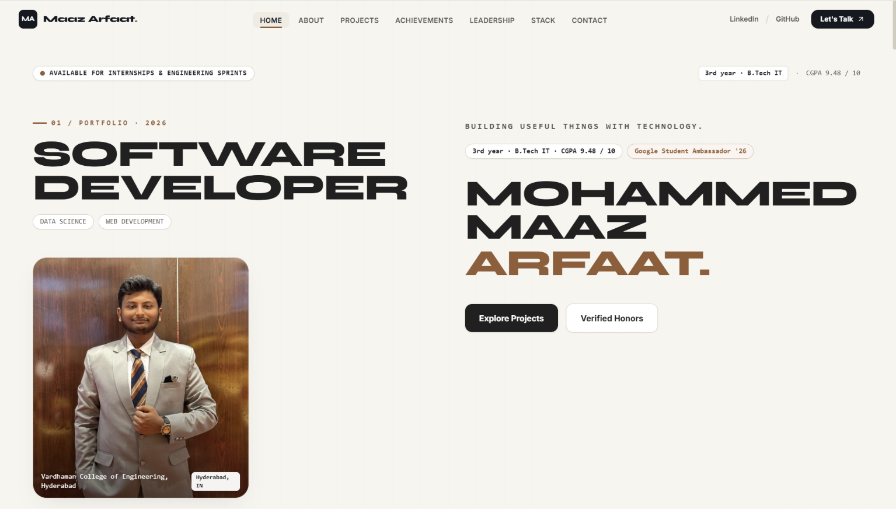
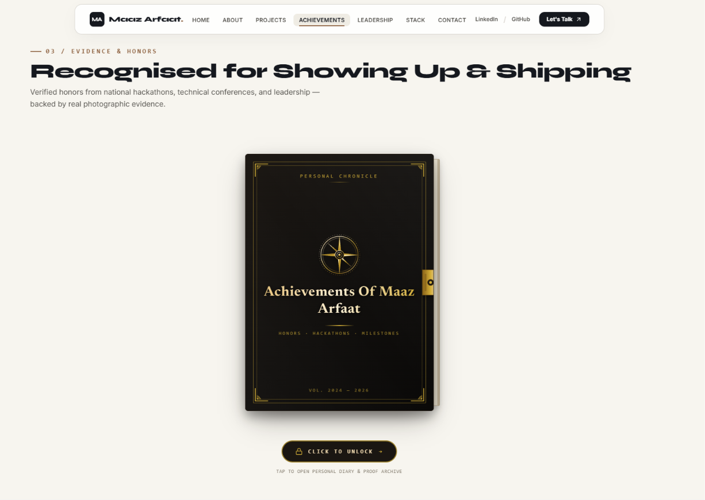
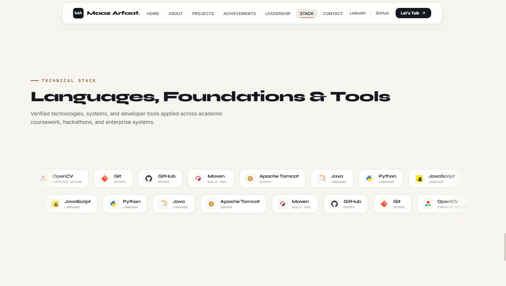

# Maaz Arfaat — Personal Portfolio

<p align="center">
  <strong>Building useful things with technology.</strong>
  <br />
  Personal portfolio featuring my projects, achievements, experience, and journey as a developer.
  <br /><br />
  <a href="https://maazarfaat.vercel.app/"><strong>🌐 View Live Portfolio</strong></a>
  &nbsp;·&nbsp;
  <a href="https://github.com/Maazarfaat"><strong>GitHub Profile</strong></a>
</p>

---

## Portfolio Preview

### Homepage

<p align="center">
  
</p>

### Achievements Journal

<p align="center">
  
</p>

### Technology Stack

<p align="center">
  
</p>

---

## About

This portfolio presents my background, the projects I build, achievements I have earned, and experiences that continue to shape my development journey. Its visual identity combines warm ivory, charcoal typography, and warm-brown accents with expressive typography and interactive sections.

## Highlights

- **Personal introduction:** background, interests, and approach to building.
- **Project showcase:** selected projects and their supporting visuals.
- **Achievements journal:** a diary-inspired presentation of awards and recognition, with supporting proof.
- **Leadership and experience:** training, opportunities, and campus responsibilities.
- **Technology stack:** a visual overview of the technologies and tools featured on the site.
- **Responsive design:** layouts adapted for desktop, tablet, and mobile.
- **Contact links:** ways to connect and explore my work.

## Tech Stack

- React
- Vite
- JavaScript / TypeScript
- CSS
- Vercel for deployment

## Run Locally

### Prerequisites

- Node.js and npm
- Git

### Setup

```bash
git clone https://github.com/Maazarfaat/Maazarfaat-Portfolio.git
cd Maazarfaat-Portfolio
npm install
npm run dev
```

Open the local URL printed by Vite in the terminal.

### Production Build

```bash
npm run build
```

Vite generates the production build in the `dist` directory.

## Live Demo

**Portfolio:** [maazarfaat.vercel.app](https://maazarfaat.vercel.app/)

## Connect

- **GitHub:** [Maazarfaat](https://github.com/Maazarfaat)
- **Portfolio:** [maazarfaat.vercel.app](https://maazarfaat.vercel.app/)

---

<p align="center"><em>I'm still learning, still experimenting, and this is just the beginning.</em></p>
